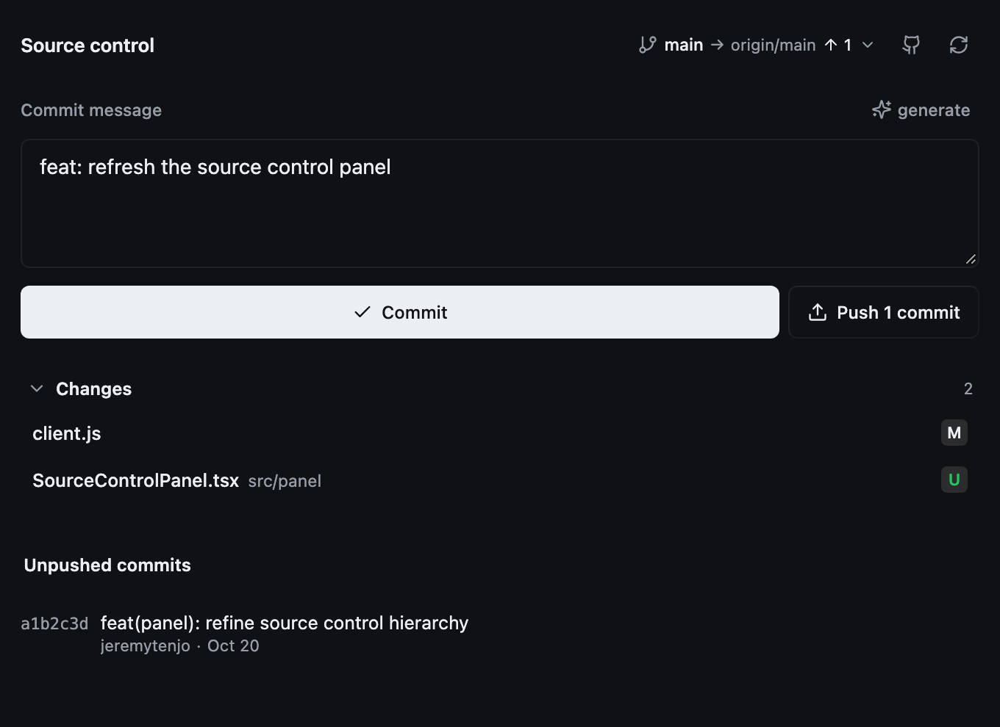
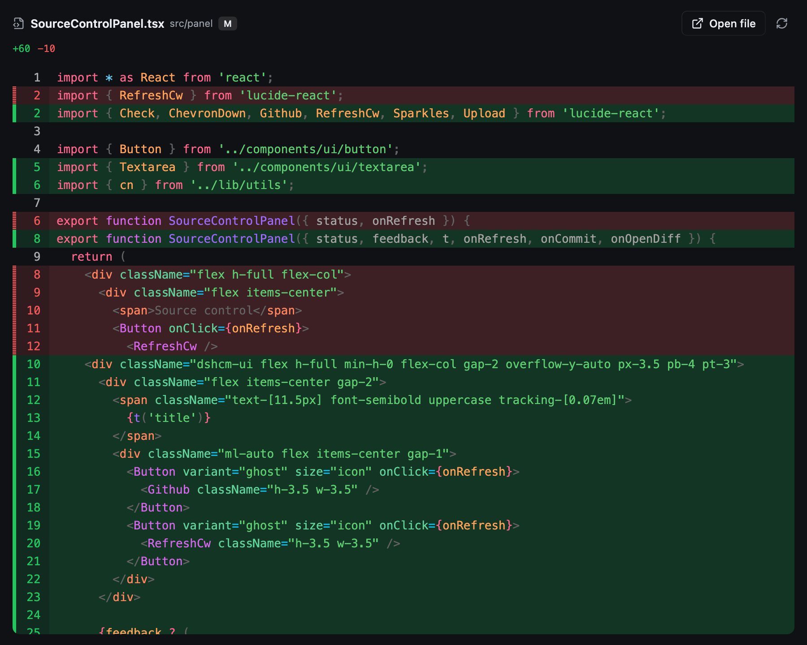
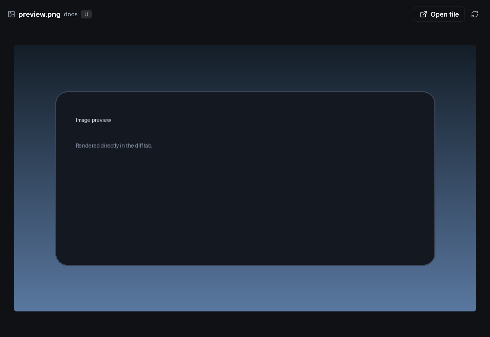
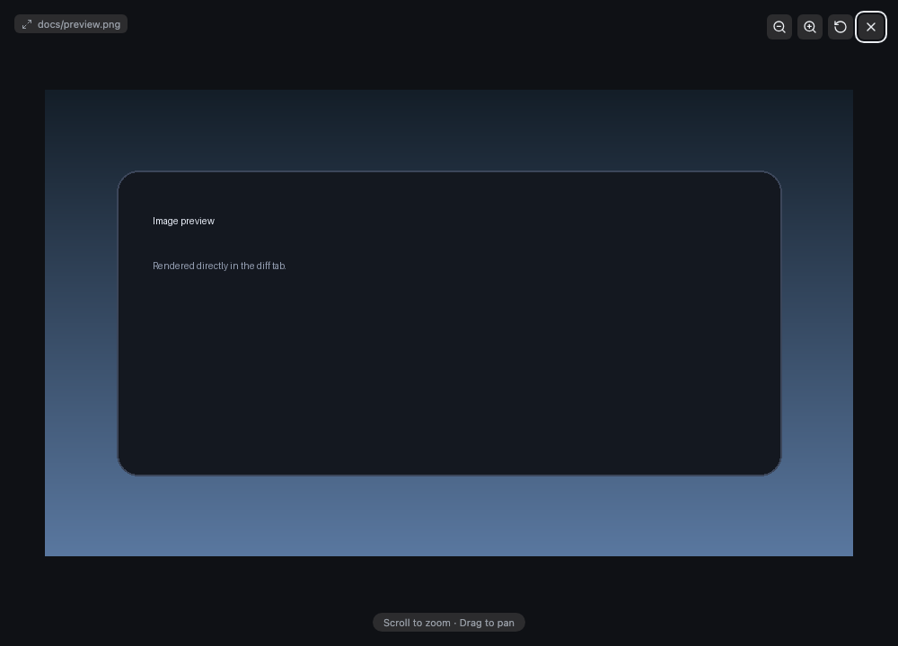

# Source Control for DeepSeek Harness

Review changes, generate commit messages, commit, push, and manage GitHub repositories from the session's right sidebar.

<p align="center">
  
</p>

<p align="center">
  
</p>

## Features

- Generate a Conventional Commits message from the current diff using the session's model.
- Commit all changes with `git add -A` and `git commit`; hooks are respected.
- Per-file diff view with Shiki syntax highlighting from `@pierre/diffs`, line numbers, hunk separators, and worktree-vs-`HEAD` context.
- Preview changed images, video, and audio directly in the diff panel.
- Click an image to open a full-screen viewer with wheel/pinch zoom, drag-to-pan, and a close button.
- Right-click a line in the diff to open the file in VS Code at that line.
- Push unpushed commits to the configured upstream.
- Open the connected GitHub repository, or create a private/public repository with `gh`.
- Restart the app and Host from a dead-session error.
- English and Chinese UI.

## Media previews

Images, video, and audio render in place of a text diff. Media is streamed from a loopback-only route with range support for seeking. Click an image to open a full-screen viewer powered by `react-zoom-pan-pinch`; scroll or pinch to zoom, drag to pan, and press Escape or the close button to exit.

<p align="center">
  
</p>

<p align="center">
  
</p>

## Requirements

- DeepSeek Harness `0.2.1-rc.2`.
- Git, with an upstream branch for pushing.
- A configured model for message generation.
- For repository creation: GitHub CLI (`gh`) installed and authenticated with `gh auth login`.
- For **Open in VS Code**: VS Code installed with the `code` command on `PATH`.

## Install

```bash
git clone https://github.com/jeremytenjo/deepseek-harness-plugin-source-control.git
dsh plugin --profile desktop add ./deepseek-harness-plugin-source-control
```

Restart the Host or reload the page. Replace `desktop` with the profile name shown by `dsh --profile <name> --dump-config`.

## Usage

1. Open a Git repository in a session.
2. Click the Git button beside the composer to open the Source Control panel.
3. Write or generate a commit message, then click **Commit**.
4. Use **Push** when the branch is ahead of its upstream.
5. Click a changed file to open its diff; **Open file** shows the full file.
6. Use the GitHub icon to open the repository or create a new one.

`Cmd+Enter` / `Ctrl+Enter` in the message field commits.

## Development

The browser half is built from TSX with React, Tailwind CSS, shadcn primitives, and Lucide icons. `client.js` is the eager panel bundle; the `@pierre/diffs` renderer lives in `client.diff.js` and loads lazily.

```bash
pnpm install
pnpm typecheck
pnpm build
```

`pnpm build` regenerates `client.js`, `client.diff.js`, and the Tailwind CSS. Commit both bundles. After changing the Host half, reload the plugin (Settings → Plugins → disable/enable) or restart the Host.

## Security and limits

- Git, `gh`, and `code` commands use argv arrays, never a shell. The restart action uses Electron `app.relaunch()`.
- The diff view compares the working tree with `HEAD`; it does not browse history or arbitrary revisions.
- Diff highlighting runs on the main thread, and the lazy diff chunk is about 10 MB.
- Media previews show the current working-tree file; deleted media falls back to the binary note.
- GitHub support targets `github.com` only.
